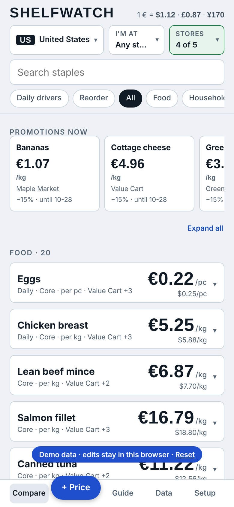
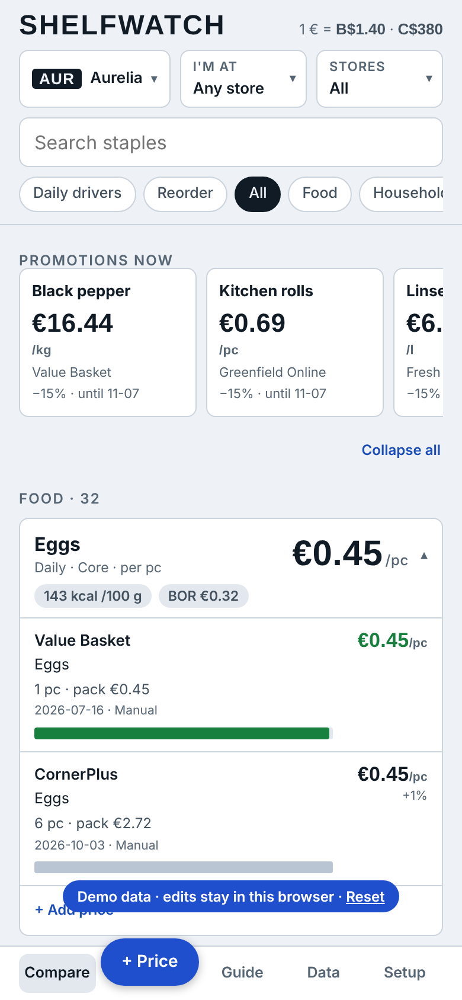

# Shelfwatch

[](https://github.com/aikitpete/shelfwatch-staples-intelligence/actions/workflows/pages.yml) [](LICENSE) [](https://aikitpete.github.io/shelfwatch-staples-intelligence/)  

Mobile-first price comparison for everyday staples across any set of countries and currencies you configure.
Every price is compared per kg, per litre or per piece, shown in EUR with the native currency beneath, and
stored with its source, origin and date. Prices are append-only, so price history is never lost.

**Live demo:** https://aikitpete.github.io/shelfwatch-staples-intelligence/ (demo data, edits stay in your browser)

<p> </p>

## What it does
- **Compare** staples per unit, with a ladder of the best shops, promo end dates and "old price" warnings.
- **In-store mode**: pick the shop you are in and see only its prices and where it beats the rest.
- **Stores**: scoreboard of which shop is cheapest most often and how much dearer the others are, the items where the shop choice matters most, and a country price-level index (basket = 100 in a reference country).
- **Home currency**: switch every price between EUR, the currencies in your data and USD from the top bar.
- **Import**: photo of a shelf or receipt (Claude vision), pasted text, or JSON from any LLM.
  Rows are checked before saving. Units that differ from the item's comparison unit are converted and highlighted.
- **Data**: price history, freshness, coverage, a failed-fetch report ranked by fixability, SQL export for Supabase.
- **Guide**: buying rules, loyalty programs and a scored register of price sources.

## Architecture
Plain JavaScript and CSS (`src/app.js`, `src/app.css`) inlined into a single self-contained page by `scripts/build.py`, no framework. The app talks to a tiny storage interface
(`db.collection().onSnapshot`, `db.doc().set/update/delete`), with two backends:

| Target | Backend | Use |
|---|---|---|
| `claude` | Claude artifact database | private, real data, photo reading, scheduled research |
| `demo` | static JSON in `data/demo/` + browser localStorage | public showcase, GitHub Pages |

Countries, currencies and shop priorities live in a config file, not in code: `data/demo-src/config.json` (invented sample countries) for the demo, `data/private/config.json` (git-ignored, your own) for the private build. See `data/config.example.json`.
Swap the data by replacing the files in `data/demo/` (or set `window.SHELFWATCH_DATA` to another folder).
A future Supabase backend only needs to implement the same few calls; `schema.sql` is the matching Postgres schema.

## Run
```bash
python3 scripts/build.py demo            # writes dist/demo/
cd dist/demo && python3 -m http.server   # open http://localhost:8000
python3 scripts/build.py claude          # writes dist/claude/page.html (publish as a Claude artifact)
```

## Keeping private data private
- The public demo is fully invented: sample countries, shops and prices from `python3 scripts/make_demo.py` (seeded, reproducible). Nothing in `data/demo/` comes from a real database.
- `data/private/` is git-ignored. Your real config and exports live there and never get committed.
- API keys never belong in the repo.

## Data notes
Item names and per-100 g reference nutrition are generic public facts (USDA FoodData Central). All shops, prices, programs and exchange rates in the demo are made up. Treat them as illustrative, not a live price feed.

MIT licence.
